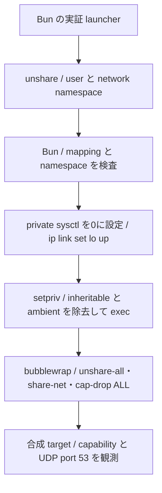

# Bun と OS ツールによる namespace の実証

[#34](https://github.com/treflebonbon/skills/issues/34) の実証用 fixture と記録。Linux / WSL2 x86_64 では、`unshare` で user / network namespace を作ってから Bun を起動し、準備後に `setpriv` で capability を落とす候補が成立した。本番 orchestrator は変更していない。通常 Linux と aarch64 は未確認で、対応範囲全体での採用は未確定。#34 の完了や後続の依存解除の根拠にはしない。

## 比較対象と観測境界

基準は `3ff7907083814d081114f96ae10e6a192541ac8e` の [codex-namespace.py](../share/codex-isolation/codex-namespace.py)。SHA-256 は `fa1b9de47711a6c25df0c2049ee1db10c29db89d83f3c0aa6564b2fe36cdc332`。実 [main](../share/codex-isolation/codex-namespace.py) を `runpy` で読み、`os.execv` の直前だけ観測を追加する。UID/GID mapping、`setgroups`、user / network namespace の inode、capability の5集合、sysctl を記録した後、元の `os.execv` を呼ぶ。観測を追加しない旧 CLI の直接起動でも終了37と port 53 の成功を確認する。通常の Bun suite からこの Python 比較を暗黙には起動しない。

[候補の fixture](../tests/fixtures/bun-namespace.ts) は既存の `lib/bun/run` を通して Bun を起動する。FFI、addon、新規 native helper は使用しない。観測は `/proc/self/`、network interface、合成の UDP 通信で行い、[process のテスト](../tests/bun/namespace.test.ts)から stdout / stderr・終了状態を検査する。新しい user / network namespace を確認する前に sysctl と loopback を変更しない。



`unshare --user --map-current-user --net --keep-caps` が namespace と本人だけの mapping を作る。Bun 内で `unshare(2)` を直接呼ぶ方式は評価していない。user / network namespace の作成は、複数 thread を持ちうる Bun を起動する前に OS ツールへ委ねる。

## 実測結果

2026-11-13 の Linux / WSL2 x86_64、非 root UID/GID 1000 で確認した。全て保護された検証入口の内側で実行し、通常 HOME・共有設定・host の sysctl は変更していない。検証 process の user / network namespace、UID/GID mapping、`setgroups`、sysctl が実行前後で同一であることも検査する。

| 境界                  | 旧版と候補の実測                                                                                                          |
| --------------------- | ------------------------------------------------------------------------------------------------------------------------- |
| 準備段階の UID/GID    | 1000 / 1000。`uid_map` / `gid_map` はそれぞれ `1000 1000 1`。`setgroups` は `deny`                                        |
| network               | 親と異なる namespace。準備後は `lo` のみ。bubblewrap の前後で同じ private network を保持                                  |
| user namespace        | 親と異なる namespace。bubblewrap がさらに namespace を作る。最終 mapping は旧版・候補とも `1000 0 1`、最終 UID/GID は1000 |
| loopback / port       | `127.0.0.1` を観測。全 capability の除去後に UDP port 53 を bind し、合成 datagram を送受信                               |
| private sysctl        | `net.ipv4.ip_unprivileged_port_start=0`。対照として1024へ設定すると、最終 target の bind は `EACCES`                      |
| 旧版の exec 直前      | permitted / effective / bounding は非0、inheritable / ambient は0                                                         |
| 候補の準備中          | `--keep-caps` により5集合が非0。Bun と `ip` の起動をまたいで必要な権限を保持                                              |
| bubblewrap の起動直前 | 旧版・候補とも inheritable / permitted / effective / ambient は0、bounding は非0                                          |
| bubblewrap の内部     | 旧版・候補とも5集合が全て0                                                                                                |
| 終了状態              | 合成 target の終了37を外側まで保持。OS ツールの SIGTERM は signal 名と終了143を記録                                       |
| Python 非依存の候補   | Python のない PATH で同じ正常系が成立。比較元の Python は実証時だけ必要                                                   |

bubblewrap の内部の mapping は、準備段階の mapping と異なる。途中の namespace に対する番号であり、旧版と候補の同じ段階を比較する。準備段階と最終段階の literal が一致するという当初のテスト仮定は、旧版自体の実測と矛盾したため修正した。

`--keep-caps` のまま bubblewrap へ渡す対照では、非 root の capability を検出して `Unexpected capabilities but not setuid` で拒否される。`setpriv --inh-caps=-all --ambient-caps=-all` を通す候補は受理される。`--keep-caps` を省く対照は、exec 後の sysctl 書込みで拒否される。単に namespace の作成が成功することだけでは採用条件を満たさない。

この保持・除去の設計は [unshare(1)](https://man7.org/linux/man-pages/man1/unshare.1.html)、[capabilities(7)](https://man7.org/linux/man-pages/man7/capabilities.7.html)、[bubblewrap の権限検査](https://github.com/containers/bubblewrap/blob/v0.12.0/bubblewrap.c)も参照する。API と資料の存在だけで成功扱いせず、上記の版・環境での実測に限定する。

## 失敗時の結果

- 共有 network namespace で準備を直接呼ぶと、sysctl 書込み前に終了1となる。
- `unshare`・`ip`・`setpriv`・`bwrap` を失敗する合成 executable に置き換えると、各段階で停止し、target の出力は現れない。`unshare` / `setpriv` / `bwrap` の終了23 / 25 / 26は外側まで伝わる。`ip` の終了24は失敗理由に保持し、準備全体は終了1となる。
- `unshare` 不在でも明示的に失敗し、隔離なしの再実行を行わない。
- namespace 作成権限、sysctl 書込み権限、capability の除去、bubblewrap のいずれかが成立しない環境でも、同じ拒否を維持する。host の sysctl や AppArmor 設定を自動変更して成立させない。

## 対応環境・再実行

| 項目                        | ローカル実測                                              |
| --------------------------- | --------------------------------------------------------- |
| OS / kernel / architecture  | Linux / WSL2 `6.18.58.1-microsoft-standard-WSL2` / x86_64 |
| Bun                         | 1.4.4                                                     |
| `unshare` / `setpriv`       | util-linux 2.39.3                                         |
| `ip`                        | iproute2 6.1.0、libbpf 1.3.0                              |
| bubblewrap                  | 0.12.0                                                    |
| 比較元 Python               | 3.14.7、`os.unshare` 対応版                               |
| 通常 Linux x86_64 / aarch64 | 未確認                                                    |
| WSL2 aarch64                | 未確認                                                    |
| macOS                       | raw isolation の対象外                                    |

検証用の追加 npm package、自動 install、build はない。比較元以外の候補が必要とする OS ツールは `unshare`・`setpriv`・`ip`・`bwrap` と既存の Bash / Bun。標準の Linux user namespace、network namespace、ambient capability と namespace 内の sysctl 書込みを許す kernel / 実行 policy が必要になる。必要なツールの版の下限を、この1環境から推定しない。

`~/runtime/skill-harness.md` の保護された検証入口から、task worktree を指定して実行する。

```sh
python3 -B /home/ubuntu/ghq/github.com/treflebonbon/dotfiles/scripts/verification_env.py \
  /home/ubuntu/orca/workspaces/skills/bun-namespace -- \
  env NAMESPACE_PROOF_REAL=1 lib/bun/run test tests/bun/namespace.test.ts
```

ローカルでは13件が pass、失敗・skip は0。末尾の `boundary: "namespace"` の JSON に source revision、比較元と候補の source hash、版、namespace / capability の観測値、合成失敗の状態が残る。dirty checkout で実行する場合の source revision は base の HEAD なので、同じ記録の候補 source hash も照合する。

通常の `npm run test:bun` は共有 namespace での拒否を検査し、実 namespace の12件は明示 opt-in まで skip する。既存の3環境 CI は raw isolation を起動しない。この skip は OS 対応の証拠に数えない。opt-in の検証で必要なツールや権限がなければテストを失敗させ、成功へ置き換えない。

## 残る判断

WSL2 x86_64 の合成境界では、追加 native helper なしの候補が成立した。通常 Linux / aarch64 と配布先の実効 policy、Nix closure に入れる OS ツールと版の固定は未確認であり、#35 と後続の移植時に確認する。#34 は open を維持し、対応範囲での採用判断を `ready-for-human` として残す。

fixture の bubblewrap は保護済み filesystem を読み取り専用で再公開する合成構成であり、raw orchestrator の秘密情報の選別や完全な filesystem / PID / gateway 設計の受入ではない。複数段階の Bun 親子 process を使うため、同一 PID への置換や FD・signal の互換性は #33 の判断を引き継ぐ。通常利用向けの entry と製品の方式は未採用。

公開入口と本番 orchestrator を変更していないため、今回の repo 外の呼び出し元の更新はない。将来の切り替え ticket では dotfiles 側の raw 起動と Nix runtime closure へ OS ツールを含め、必要な版と拒否条件を確認する手順を報告する。repo 外の設定変更と本番配備は実行しない。
