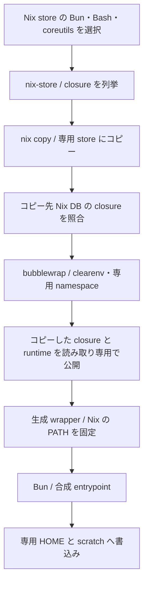

# Nix closure 内の Bun と生成 wrapper の実証

[#35](https://github.com/treflebonbon/skills/issues/35) の実証用 fixture と記録。Linux / WSL2 x86_64 では、選択した Bun と closure を専用 store へコピーし、読み取り専用の runtime copy にある生成 wrapper から Bun を起動できた。通常 Linux / aarch64 と配布先での受入は未確認で、対応範囲全体での採用は保留する。本番 tools 一覧と wrapper は切り替えていない。

## 比較する境界と選択する tool

[既存の隔離処理](../share/codex-isolation/secret-isolation-worktree.py)は、選択した tool の実体を Nix store に限定し、`nix copy --to DIRECTORY --no-check-sigs` と `nix-store --query --requisites` で専用 store と closure の読み取り専用 mount を準備する。今回の[実証 CLI](../tests/fixtures/bun-nix-runtime.ts)は同じ OS コマンドと bubblewrap の構成を使い、Bun・Bash・coreutils を roots とする。製品関数を呼び出した end-to-end の検査ではなく、Bun の追加に必要な closure と起動条件を切り出した合成 fixture である。



選択した Bun は `/nix/store/0m78sw4631vp4b3awfi0cr5laj0375qa-bun-1.4.4/bin/bun`。binary の SHA-256 は `111aefb9597cb10b201e2f3a40407f1557ac6714868481db14c6cb21ebd5cd7c`。Bun 単体の closure は5 paths、Bash・coreutils を合わせた closure は12 paths だった。roots、全 closure、選択した各 executable、版、Bun の hash を JSON に記録し、コピー元とコピー先 DB の集合が一致しなければ停止する。

[nix copy の公式資料](https://github.com/NixOS/nix/blob/master/src/nix/copy.md)と [requisites の公式資料](https://github.com/NixOS/nix/blob/master/doc/manual/source/command-ref/nix-store/query.md)も参照する。コピー先は `file://` cache ではなく directory 形式の store。インストール済みの store paths だけを入力にし、外部 flake の評価・更新や package の取得は行わない。

## 隔離内の起動と書込み

合成 root は tmpfs とし、コピーした closure の各 path、runtime copy、`/proc`、`/dev`、専用 HOME / scratch / work だけを公開する。host の `/nix/store` 全体、`/usr/lib`、`/lib` は bind しない。user・filesystem・PID・network namespace を作り、全 capability を落とす。

runtime copy は既存 `lib/bun/run` とその config、TypeScript の観測用 entrypoint、生成 wrapper からなる。wrapper の shebang は選択した Nix Bash の絶対 path、PATH は選択した Bun・Bash・coreutils の `bin` に固定する。初期 PATH を使えない値にしても起動する。現在の本番 runtime copy への追加は行っていない。

| 境界                  | ローカルでの結果                                                                                                                           |
| --------------------- | ------------------------------------------------------------------------------------------------------------------------------------------ |
| clear environment     | 外側へ合成変数を注入しても target には届かない                                                                                             |
| 選択 Bun              | 内側の executable path と版が選択値に一致する                                                                                              |
| HOME / scratch        | `/home/agent` と `/scratch` に書込み・読戻しが成功する                                                                                     |
| runtime / Bun package | 新規ファイルの作成は両方 `EROFS` で拒否される                                                                                              |
| host の canary        | 実在する合成ファイルは内側で見えず、元の bytes を保持する                                                                                  |
| cache                 | `BUN_RUNTIME_TRANSPILER_CACHE_PATH=0`。実行前後で runtime copy の bytes・mode・file inventory と、元の `lib/bun` の fingerprint が一致する |
| 依存解決              | 未導入の合成 package は内側の Bun で拒否され、payload / work に `node_modules` を作らない                                                  |
| 終了状態              | 合成 target の終了37を外側まで保持する                                                                                                     |

payload の書込み拒否と正常起動を併せて確認する。読み取り専用の mount が存在することだけを、Bun がその環境で利用できる根拠にはしない。Nix によるコピーは専用 store にだけ行い、実証の実行時に host の許可外領域へ書込む構成は持たない。

## 拒否の対照

[テスト](../tests/bun/nix-runtime.test.ts)は process の stdout / stderr・終了状態、保存された manifest、生成物を観測する。

- Nix store 外の Bun は state の作成と copy の前に拒否する。
- 保存後に tool を Nix store 外の合成 executable へ変更すると、実行前に拒否し、その executable の marker を作らない。
- Bun の package を mount しない対照は終了2となり、host の Bun に fallback しない。
- package root だけを公開する対照は、共有ライブラリを含む closure が不足して `execvp` / `No such file or directory` で拒否される。同じ wrapper と完全な closure の対照は成功する。
- `--version` に1.2.14を返す合成 executable を内側の選択 Bun に重ねた対照は、既存 `lib/bun/run` が終了2で拒否し、本体実行の marker を作らない。旧 Nix Bun の実バイナリを入手して動かした証拠とは区別する。
- 未導入 package の import は実際の隔離内 Bun まで到達した後に拒否される。自動 install や隔離なしの再実行を行わない。

## 対応環境と再実行

2026-11-13 に確認した環境は Linux / WSL2 x86_64、kernel `6.18.58.1-microsoft-standard-WSL2`、Bun 1.4.4、Nix 2.34.6、Bash 5.3p9、coreutils 9.11、bubblewrap 0.12.0。7件が pass、失敗・skip は0。Bun 1.4.4 以上という既存 runner の条件を維持し、移行全体の最低版や Nix の下限をこの1環境から推定しない。

`~/runtime/skill-harness.md` の保護された検証入口から task worktree を指定する。

```sh
python3 -B /home/ubuntu/ghq/github.com/treflebonbon/dotfiles/scripts/verification_env.py \
  /home/ubuntu/orca/workspaces/skills/bun-nix-runtime -- \
  env NIX_BUN_PROOF_REAL=1 lib/bun/run test tests/bun/nix-runtime.test.ts
```

末尾の `boundary: "nix-runtime"` の JSON に source revision、fixture source hash、選択 tool と closure、準備時間、不変性の結果を残す。dirty checkout では HEAD と fixture source hash を併せて照合する。準備は test file ごとに一度だけ行い、終了後に自分が作った専用 store を片付ける。追加の npm package、FFI、native build は不要。

通常の Bun suite は Nix store 外の Bun の拒否を検査し、実隔離の6件は明示 opt-in まで skip する。未実行時の JSON は `realIsolation: "not-requested"` とし、Nix がない CI の成功を実証の成功に数えない。opt-in 時の tool・権限・版の不足は失敗にする。通常 Linux / aarch64、WSL2 aarch64 は未確認。macOS と Windows native は raw isolation の対象外。

## repo 外の切り替えと残る判断

現在の dotfiles source には `private_dot_config/nix-devshell/modules/runtimes.nix` の Bun 定義と、`flake.nix` の `nixpkgs-language-sources` 選択がある。今回の実効 PATH では Nix Bun 1.4.4 が利用できたが、その store path と現在の外部 flake の再評価結果の同一性は未確認である。

後続の本番切り替えでは、対象 devShell の pin で必要な Bun を解決できるか確かめ、Bun を明示的な tool root として closure に含める。runtime copy に `lib/bun/run`・config と移植済み TypeScript を含め、生成 wrapper の shebang と PATH を選択済みの store paths へ固定する。必要な版を取得できなければ、外部 flake を自動更新せず、pin の選択を判断事項として残す。

今回の公開入口と repo 外の呼び出し元に変更はない。dotfiles の PATH / flake、共有設定、認証、配備は変更していない。実証は Bun entrypoint の起動を対象とし、隔離内 Nix の評価・build・追加 store 書込み、実モデル・gateway、全製品 wrapper の受入は未実施。同一 PID・FD・signal と namespace の採用判断は #33・#34 を引き継ぐ。

WSL2 x86_64 の候補は成立したが、必要な対応範囲と配布先での採用条件は確定していない。#35 は open / ready-for-human として判断事項を残し、後続の blocking links は解除しない。
