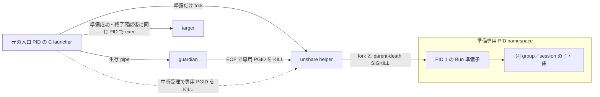

# 準備子孫の終了方式：OS 別候補と一次資料

調査日: 2026-11-15

ユーザーは全子孫の5秒保証を維持して再設計する方針を承認した。以下は方式の候補と追加実証であり、各 OS での採用・新しい依存の導入・製品化を承認済みとは扱わない。

## 前提と調査境界

[ADR 0002](adr/0002-native-exec-and-perl-flock.md) と[既存 proof](bun-process-lock-proof.md)が定める受入条件を引き継ぐ。SIGTERM 等の中断は受理した時点、launcher だけへの SIGKILL は試験側が送信した時点から、準備のために起動した全子孫を5秒内に停止する。準備中の target は起動せず、無関係な process と起動後の target は終了対象にしない。正常な準備全体に5秒の上限は設けない。成功時は target の元の PID／PPID／PGID／TTY／FD と CLOEXEC／signal mask・ignore／argv／env を維持する。

既存 proof の末尾では、現 guardian が準備 process group に SIGKILL する方式が、`setpgid`／`setsid` で別 group／session へ離脱した TERM-ignore 子・孫を終了できず、launcher 終了後5.119〜5.132秒にも2 process が残ると Linux／WSL2 x64 で観測されている。これは現方式の反証であり、macOS での実測でも、代替方式が存在しない証明でもない。

Apple・XNU・Linux kernel・FreeBSD の公開文書／公開ソースを照合し、Linux では後述する一時 fixture を保護された検証環境で実行した。macOS arm64 実機での compile／実行はしていない。XNU／launchd の `main` は可変参照のため、対象 macOS 版で実際に提供される挙動は別途確認が必要。以下の「資料で確認」は資料が明記する契約、「推測」はその契約からの設計上の帰結、「未確認」は資料だけでは保証されない事項を表す。

## 結論

今回確認した Apple の公開一次資料の範囲では、通常の CLI／helper が任意に fork し、`setpgid`／`setsid` で離脱した子孫を、親 launcher の SIGKILL 後も5秒内に一括終了させる公開機構は確認できなかった。macOS 27.0.0 以降として availability が記載された `es_new_descendants_client` は caller と全 descendant を対象にする公開監視 scope であり、別 guardian を prep の親にしてその client を作る案が候補になる。ただし監視 scope API だけで一括終了や event 欠落時の回復が保証されるとは資料から確認できず、この設計も未実証である。これは調査範囲の結論であり、「macOS では不可能」という断定ではない。

`launchd` は同一 PGID 内の残存 process を管理する候補だが、子孫全体の一括終了 API ではない。kqueue の fork tracking は必要な公開保証を欠く。XNU の `libproc.h` は private interface で変更され得ると記す一方、いくつかの列挙・情報取得関数には availability 宣言もあるため、全 `proc_pidinfo` 関数が一律に利用禁止とは言えない。PID snapshot polling には fork・reparent・PID 再利用との競合が残る。Endpoint Security の descendant client は entitlement を要し macOS 27.0 以降だが、別 guardian を prep の親として client を作る設計は system-wide broker を要しない可能性がある。restricted entitlement を持つ helper の署名・配布と既存の明示 `cc` host build との両立、event 欠落時の回復、一括終了手段は未解決である。

Linux には、fork と migration の競合を扱う cgroup v2 `cgroup.kill` と、PID namespace init 終了時に kernel が namespace 内 process を SIGKILL する仕組みがある。これは OS ごとに管理方式を変える根拠になるが、権限・配布・parent-SIGKILL watchdog・target identity の受入は方式ごとに確認する必要がある。[cgroup v2 の仕様](https://www.kernel.org/doc/html/latest/admin-guide/cgroup-v2.html)と[PID namespace の仕様](https://man7.org/linux/man-pages/man7/pid_namespaces.7.html)を参照。

**次の正式な実証対象には、Linux の準備専用 PID namespace を推奨する。** 一時試験では離脱子孫の終了と target の非 TTY の契約を対照できた。cgroup は現在の host で write 権限がなく、委譲の変更を要するため先行させない。macOS は未実証のまま保留し、対応 OS の下限や署名・配布の契約を自動で変えない。#33 の完了と #82 の解禁には、必要な対応範囲での根拠が引き続き必要になる。

## 方式比較

| 方式                                                   | 依存・権限・daemon／installer                                                                                                                                                                                                                                                                                                                                                                                                                                                           | launcher だけ SIGKILL 時の watchdog                                                                                                                                                                                                                                                                                                                  | fork／detach／teardown 競合                                                                                                                                                                                                                                                                                                                                                                         | target への非干渉                                                                                                                                                                                                                                                                                                                                                                                                                                                                                                                                                                                                                                                                                                               |
| ------------------------------------------------------ | --------------------------------------------------------------------------------------------------------------------------------------------------------------------------------------------------------------------------------------------------------------------------------------------------------------------------------------------------------------------------------------------------------------------------------------------------------------------------------------- | ---------------------------------------------------------------------------------------------------------------------------------------------------------------------------------------------------------------------------------------------------------------------------------------------------------------------------------------------------- | --------------------------------------------------------------------------------------------------------------------------------------------------------------------------------------------------------------------------------------------------------------------------------------------------------------------------------------------------------------------------------------------------- | ------------------------------------------------------------------------------------------------------------------------------------------------------------------------------------------------------------------------------------------------------------------------------------------------------------------------------------------------------------------------------------------------------------------------------------------------------------------------------------------------------------------------------------------------------------------------------------------------------------------------------------------------------------------------------------------------------------------------------- |
| 現行の専用 PGID + guardian                             | macOS 標準 process group。追加 install なし。                                                                                                                                                                                                                                                                                                                                                                                                                                           | guardian は pipe EOF を見て元 PGID を KILL するが、別 PGID は見えない。                                                                                                                                                                                                                                                                              | 同一 group の fork は回収できても、`setsid`／`setpgid` で離脱した子孫を逃す。既存 WSL2 fixture で不適合を確認済み。[Apple `setsid(2)`](https://developer.apple.com/library/archive/documentation/System/Conceptual/ManPages_iPhoneOS/man2/setsid.2.html)、[Apple `setpgid(2)`](https://developer.apple.com/library/archive/documentation/System/Conceptual/ManPages_iPhoneOS/man2/setpgid.2.html)。 | launcher が成功後に元 PID で exec する構成なら守れるが、全子孫の条件を満たさない。[既存 proof](bun-process-lock-proof.md)。                                                                                                                                                                                                                                                                                                                                                                                                                                                                                                                                                                                                     |
| `launchd` job／XPC service                             | OS 標準。継続稼働する launchd job を使うなら plist 等の登録・管理が要る。system LaunchDaemon は特権的な配置・管理を伴う。全体を launchd 起動にすると呼出し元との PID／PPID 関係が変わる。                                                                                                                                                                                                                                                                                               | launchd は job を管理する。別 launcher から起動された準備 job が launcher の死を自動検知するとは資料から確認できないため、pipe watcher 等が必要という設計上の推論が残る。`ExitTimeOut` の既定は20秒。                                                                                                                                                | Apple OSS の `launchd.plist` man source は `AbandonProcessGroup` を job と同じ PGID の残存 process に限定して説明する。値を小さくしても別 group／session は拾わず、5秒以内の全子孫終了も資料上の保証ではない。                                                                                                                                                                                      | 本来の launcher を残し、そこから target を exec する場合に限り target identity を保てる。launchd/XPC から target を直接起動すれば受入契約を変える。[Apple OSS launchd.plist](https://github.com/apple-oss-distributions/launchd/blob/main/man/launchd.plist.5)、[Apple launchd jobs guide（archive）](https://developer.apple.com/library/archive/documentation/MacOSX/Conceptual/BPSystemStartup/Chapters/CreatingLaunchdJobs.html)。                                                                                                                                                                                                                                                                                          |
| kqueue fork event + `libproc` tree polling             | kqueue は OS 標準。XNU `libproc.h` に `proc_listchildpids` 等の availability 宣言がある一方、header 全体は private interface／変更対象と明記。daemon は不要。                                                                                                                                                                                                                                                                                                                           | launcher 内 monitor は launcher と同時に消える。別 monitor／guardian が必要。                                                                                                                                                                                                                                                                        | XNU `event.h` は `NOTE_TRACK`／`NOTE_TRACKERR`／`NOTE_CHILD` を10.5以降非対応と記す。`NOTE_FORK` で child PID は `kevent` 結果へ渡らない。`proc_listchildpids` は PPID 指定の直接子一覧なので再帰 snapshot が要る。fork と一覧取得の競合、途中親の終了後の reparent、PID 再利用が残る。                                                                                                             | 列挙・kill の競合を解けず、private／変更され得る header を含む設計のため、公開契約で受入条件を満たすとは確認できない。これは全 `proc_pidinfo` 関数が利用禁止という意味ではない。[XNU event.h](https://github.com/apple-oss-distributions/xnu/blob/main/bsd/sys/event.h)、[XNU libproc.h](https://github.com/apple-oss-distributions/xnu/blob/main/libsyscall/wrappers/libproc/libproc.h)、[Apple OSS libproc 実装](https://github.com/apple-oss-distributions/xnu/blob/main/libsyscall/wrappers/libproc/libproc.c)。                                                                                                                                                                                                            |
| Endpoint Security descendant client + per-run guardian | 公開 C API。`es_new_descendants_client` は macOS 27.0.0 以降。restricted `com.apple.developer.endpoint-security.client` entitlement と provisioning-profile による署名が必要。root／TCC は不要。非root caller と descendants は setuid／setgid binary を実行できず、その exec は block され process が終了する。System Extension は Apple が案内する配布形態の一つだが、API が常駐 System Extension／global broker を必須にするとは資料から確認できない。macOS-15 CI では実行できない。 | 仮説: 元 launcher が per-run guardian を起動し、guardian が descendant client を作ってから prep runner を子として起動する。launcher の SIGKILL を pipe EOF 等で検知した guardian が終了処理を始める構成を試せる。guardian が launcher より長く生存すること、検知・teardown、およびその終了処理が全 prep descendants を安全に kill することは未実証。 | API の scope は caller と既存・将来 descendants の全 subtree で、他 process は不可視。これは監視 scope であり、ES event が一括 killable な kernel process set を作るとは読めない。queue full による drop は sequence number で検知できるが、gap 後の未知 descendant の完全同定・終了と安全な process identity は未確認。                                                                            | entry launcher は従来通り target を同じ PID で exec でき、guardian の sibling subtree は target を含まない設計にできる。entitlement 付き guardian の署名・配布を通常の明示 `cc` build にどう合わせるか、一括終了 API、event drop、5秒終了は未解決。[ES descendant client](<https://developer.apple.com/documentation/endpointsecurity/es_new_descendants_client(_:_:).md>)、[restricted entitlement を持つ daemon](https://developer.apple.com/documentation/xcode/signing-a-daemon-with-a-restricted-entitlement)、[Apple Endpoint Security／System Extension overview](https://developer.apple.com/documentation/endpointsecurity)、[WWDC: event drop と sequence](https://developer.apple.com/videos/play/wwdc2020/10159/)。 |
| Linux cgroup v2 `cgroup.kill`                          | Kernel の cgroup v2 と対象 cgroup の write 権限。親から delegation があれば root daemon を必須としないが、directory／`cgroup.procs` 等と `cgroup.kill` の利用権限が要る。delegation がなければ管理者／service manager の設定が必要。                                                                                                                                                                                                                                                    | cgroup 自体は launcher 死亡を trigger にしない。残る watchdog／owner が `cgroup.kill` を書くか、別の監視境界が必要。                                                                                                                                                                                                                                 | cgroup と descendant cgroup の process へ SIGKILL を送り、kernel doc は concurrent fork と migration を処理すると明記。delegated subtree は delegatee が外へ process を移動できない設計にできる。絶対 wall-clock 5秒の exit 完了までは資料に書かれていない。                                                                                                                                        | 元 launcher を cgroup 外に置き、準備だけを cgroup に入れて成功後に launcher が exec すれば target process metadata を変えない設計が可能。[kernel cgroup v2](https://www.kernel.org/doc/html/latest/admin-guide/cgroup-v2.html)。                                                                                                                                                                                                                                                                                                                                                                                                                                                                                                |
| Linux PID namespace init + parent-death signal         | Kernel の PID namespace。PID namespace 作成は CAP_SYS_ADMIN が必要だが、user namespace と組み合わせれば unprivileged 利用が可能な場合がある。host policy／kernel config が許可する必要があり、管理者による userns 禁止もあり得る。追加 root daemon は不要。                                                                                                                                                                                                                             | namespace init に `PR_SET_PDEATHSIG(SIGKILL)` を設定し、launcher 死亡を検出して init を終了させる。namespace init 終了時、kernel が残りの namespace process を SIGKILL する。pdeathsig は fork で継承されないため、init 自身の設定と「親がすでに消えていた」race check が必要。                                                                      | `setsid`／別 PGID は PID namespace membership を変えず、namespace init 死亡時に子孫も終了対象となる。nested PID namespace へ descend しても ancestor namespace へ戻れない。kernel doc は5秒の実時間上限は保証しない。                                                                                                                                                                               | original launcher は namespace 外に残し、準備成功後に同じ launcher が target を exec する。従って target の PID／PPID／PGID／TTY／FD／signal／argv／env を保つ設計が可能。実 caller／TTY／exec 前 inspection は別途確認。[PID namespace](https://man7.org/linux/man-pages/man7/pid_namespaces.7.html)、[PDEATHSIG](https://man7.org/linux/man-pages/man2/PR_SET_PDEATHSIG.2const.html)、[user namespace](https://man7.org/linux/man-pages/man7/user_namespaces.7.html)。                                                                                                                                                                                                                                                        |

## macOS の隣接 API と取り違え

- **Process coalition** は Apple の crash report schema で、関連 process の resource usage をまとめた ID として説明される。XNU `libproc` に `proc_listcoalitions` は見えるが、その header は private interface と宣言する。今回参照した公開資料では、第三者 CLI が任意の preparation descendants を加入させ、detach に関係なく一括 kill する公開 API／保証は確認できなかった。これは資料範囲の不在であり、内部実装全体の不存在を意味しない。[Apple crash report schema](https://developer.apple.com/documentation/xcode/interpreting-the-json-format-of-a-crash-report)、[XNU libproc implementation](https://github.com/apple-oss-distributions/xnu/blob/main/libsyscall/wrappers/libproc/libproc.c)。
- **App Sandbox／Seatbelt** は resource access の制限を提供する。今回参照した Apple の公開 App Sandbox 資料では、任意 CLI の `setsid`／`setpgid` を止める supported contract は確認できなかった。未文書化の profile rule を全子孫所有の根拠にしない。[Apple App Sandbox](https://developer.apple.com/documentation/security/app-sandbox)。
- **FreeBSD `procctl`** の `PROC_REAP_ACQUIRE`／`PROC_REAP_GETPIDS`／`PROC_REAP_KILL` は、descendant reaper と subtree signaling を明記する強い比較例である。しかしこれは FreeBSD `procctl(2)` API であり、Darwin/macOS API と混同できない。XNU に同じ公開 interface があるとはこの資料から言えない。[FreeBSD procctl(2)](https://man.freebsd.org/cgi/man.cgi?manpath=FreeBSD+16.0-CURRENT&query=procctl&sektion=2)。

## Linux 側の比較要点

### cgroup v2

資料で確認できるのは、`cgroup.kill` が cgroup と全 descendant cgroup の process に SIGKILL を送り、同時 fork と migration を処理する点である。child は fork 元と同じ cgroup に生まれる。非 root への delegation は cgroup directory と `cgroup.procs` などへの write 権限で構成し、適切な common-ancestor 権限を与えなければ subtree 外へ移動できない。したがって「作成後の tree scan」より race が少ないが、権限の委譲、準備 process だけの配置、親の death を trigger する watchdog、実際に process が5秒内に消えることを別々に検証する必要がある。[cgroup.procs／delegation／cgroup.kill の kernel doc](https://www.kernel.org/doc/html/latest/admin-guide/cgroup-v2.html)。

### PID namespace、PDEATHSIG、pidfd、subreaper

PID namespace の init が終了すると kernel はその namespace の残る全 process を SIGKILL する。PID namespace membership は process 作成時に決まり、`setsid`／PGID 変更では変わらない。これは準備 runner を namespace PID 1 にする候補の根拠になる。user namespace と併用すれば namespace 作成能力を内側に限定できる場合があるが、host の policy／mapping 条件が必要である。[Linux PID namespace](https://man7.org/linux/man-pages/man7/pid_namespaces.7.html)、[user namespace](https://man7.org/linux/man-pages/man7/user_namespaces.7.html)。

`PR_SET_PDEATHSIG` は設定した process の parent thread が後で終了したとき signal を送るが、child の `fork` 時には設定が clear される。また親が `prctl` より先に終了した場合は signal が届かない。従って namespace init child の早期設定と、設定前に親が消えたかを確認する順序が必要。これは設計上の推論で、今回の docs/source にある製品実装の受入結果ではない。[PDEATHSIG の Linux man page](https://man7.org/linux/man-pages/man2/PR_SET_PDEATHSIG.2const.html)。

pidfd は一つの特定 process を file descriptor で参照し、`pidfd_send_signal` でその process へ signal できる。`clone3(CLONE_PIDFD)` は作成した child の pidfd を返すため、child PID 再利用の窓を避けられる。ただし pidfd 自体は descendants 一式を所有せず、個別に追跡する必要がある。[pidfd_open](https://man7.org/linux/man-pages/man2/pidfd_open.2.html)、[pidfd_send_signal](https://man7.org/linux/man-pages/man2/pidfd_send_signal.2.html)、[clone(2)](https://man7.org/linux/man-pages/man2/clone.2.html)。

`PR_SET_CHILD_SUBREAPER` は orphan になった descendants の再 parent と wait を担う機能であり、live descendant を自動 kill する API ではない。単独では離脱 process の5秒 termination 保証にならない。[subreaper の Linux man page](https://man7.org/linux/man-pages/man2/PR_SET_CHILD_SUBREAPER.2const.html)。

## Linux／WSL2 の最小実証

### 構成

元の C launcher と guardian を残し、Bun 準備子を起動する `execv` の argv だけに、導入済み util-linux の `unshare --user --map-current-user --pid --fork --kill-child=SIGKILL --` を前置した一時候補を作った。これは製品入口や repo の C fixture を切り替えたものではない。

`unshare` が終了すると `--kill-child` により fork した子へ signal が届き、PID 1 の終了で kernel が namespace 内の残りを終了する。[util-linux の公式 man source](https://github.com/util-linux/util-linux/blob/v2.39.3/sys-utils/unshare.1.adoc)と[Linux PID namespace](https://man7.org/linux/man-pages/man7/pid_namespaces.7.html)。[参照した util-linux 2.39.3 source](https://github.com/util-linux/util-linux/blob/v2.39.3/sys-utils/unshare.c)には `PR_SET_PDEATHSIG` と、`UL_HAVE_PIDFD` を有効にした build での parent pidfd の確認がある。version 表記だけで全 build の初期 race が解決済みとみなさず、採用候補の実 binary で対照する。

### 実測結果

比較元は `0d5d4e3a2b919804906b8d500929811e94d69791`。Linux／WSL2 x64、kernel `6.18.58.1-microsoft-standard-WSL2`、Bun 1.4.4、gcc 15.3.0、util-linux `unshare` 2.39.3 を使い、`verification_env.py` の private user／PID namespace 内で実行した。これは通常 host 全体の受入や他の利用者の mapping の確認ではない。管理者権限や共有 cgroup 設定を変更していない。

| 離脱方法   | launcher だけへの signal | namespace 候補の終了確認 | 生存する準備 process | 無関係な sleep | target |
| ---------- | ------------------------ | ------------------------ | -------------------- | -------------- | ------ |
| 別 group   | SIGTERM                  | 10.156 ms                | 0                    | 生存           | 未起動 |
| 別 group   | SIGKILL                  | 10.182 ms                | 0                    | 生存           | 未起動 |
| 別 session | SIGTERM                  | 10.154 ms                | 0                    | 生存           | 未起動 |
| 別 session | SIGKILL                  | 10.168 ms                | 0                    | 生存           | 未起動 |

時刻は試験側の送信から測った保守的な上限で、10 ms 間隔の観測を含む。SIGTERM の受理時刻そのものは計測していないが、より早い送信時刻から5秒内に終了したことはこの候補の肯定結果になる。試験は実証用 Bash 入口、Bun 準備子、C observer を通す。開始後に外側 `/proc` の子孫関係を観測し、guardian／unshare helper／Bun PID 1／離脱した子・孫の全5 process に pidfd を開き、終了を追った。tree scan は harness の観測であり、候補の終了方式には使わない。harness の強制 cleanup は assertion 後または観測失敗時の `finally` だけである。

同じ harness の元 launcher 対照では4件とも送信後約5.1秒に observer 2 process が残った。SIGTERM の受理遅延を除いた反証は、既存 proof の launcher 終了観測後の記録を参照する。

さらに Bun PID 1 自身も `setsid` で guardian の PGID 外へ離脱させた。`--kill-child` ありでは全準備 process が10.226 msで終了し、この指定だけを除いた変異では Bun PID 1 と子・孫の3 process が5,106 ms後も残った。namespace の作成だけでは、launcher 消失を namespace init の終了へつなげられないことを対照できた。

target の比較は次の範囲で成功した。

- 継承 FD 3／9／63 の番号集合の一致と、FD 9 の device／inode・CLOEXEC を2入力で確認した。CLOEXEC の入力では FD 9 が close される。FD 3／63 の device／inode はこの試験では記録していない。
- seed と target の PID／PPID／PGID／SID、signal mask・SIGINT ignore・SIGCHLD ignore が一致した。SIGPIPE／SIGXFSZ ignore と literal argv は、旧 Python の状態へ揃える既存 C launcher の target と比較した。終了状態は37だった。
- 正常な5.2秒の準備も最後まで完了し、target は終了37となった。

この試験は非 TTY であり、実 PTY・全 argv／env corpus・実 caller の同等性を証明したものではない。

### 識別情報と再実行

| 対象                        | SHA-256                                                            |
| --------------------------- | ------------------------------------------------------------------ |
| 元 launcher source          | `4ef10c41e2dfbf5ff5c41c57f8de183bf70e621f42f4333dffaec22074c34b03` |
| namespace 候補 source       | `f22667c2a7e2c7681a331b6ceeb2c3b2648bb76056cd41a0a5ea48af220466a7` |
| observer source             | `a206c8d904a8fee13de8ad299a3a9fb0e8d9385088fb1cc856014cb5395a6b39` |
| 実行した `/usr/bin/unshare` | `a23c8863860669003dc4660039fe642f5795c8c2195898ebc5d01afa1ac3d11c` |

セッションの一時証拠は `/tmp/codex/containment-design.LQFXYU` に保持した。`probe.py` が元 source から一時候補を生成してビルドし、8条件と target の対照・5.2秒準備を実行する。`probe-parent-death.py` は準備 PID 1 自身の離脱と `--kill-child` の変異を比較する。結果は `namespace-comparison.json`、`namespace-summary.json`、`parent-death-comparison.json` に記録した。`environment.json` は導入済み unshare／setsid・入口の hash と、実験後に保持した生成実行体の hash を区別する。cgroup の読取り専用能力調査は `cgroup-capability.json` に分けた。再実行時も同じ検証 wrapper と task checkout を使い、repo 内の正式 fixture としては未採用であることを区別する。

### 依存・配布と次の実証順序

Linux の最小候補を正式に比較するなら、まず導入済み `unshare` を明示選択する fixture で進める。製品化する場合の util-linux 依存、実行体・build の識別、raw の Nix closure への追加は #82 の設計事項であり、今回の既存 `cc` 方針だけで承認済みとは扱わない。C で同等の namespace／mapping／pidfd 処理を再実装する案は、初期 race と credential の扱いを別に証明するまで、今回の結果へ置き換えない。

`--map-current-user` は user／group ID の mapping と `setgroups=deny` を伴う。[util-linux の公式仕様](https://github.com/util-linux/util-linux/blob/v2.39.3/sys-utils/unshare.1.adoc)。準備子が見る PID／PPID、UID／GID と supplementary groups、`/proc`、Nix／shellHook の挙動は確認が必要である。元 launcher を外側へ残すことで target の metadata を保つ設計と、準備処理の互換性は別の条件として扱う。

次の実証は、初期化の race、準備中の終了、caller の互換性の順で進める。

1. 準備 helper の fork 前後、parent pidfd の登録前後、`prctl` 前後、Bun ready 前を同期して止める。launcher だけの SIGKILL／中断で子孫が残らず、PID 再利用を無関係な process の終了へつなげないことを確認する。signal block／ignore・nested PID namespace も対照する。
2. 実 PTY、既存の FD／signal／argv／env corpus、exec 前 cache 検査の段階を対照する。準備中断では target を起動せず、正常な準備全体へ5秒の制限を設けない。
3. Nix の `print-dev-env` と shellHook を含む実 caller を通し、mapping と `/proc`、credential、LSM が parent-death signal へ与える影響を確認する。namespace 作成拒否・helper 不在では準備を始めず停止する条件を示し、自動 install や権限変更で代用しない。
4. Linux x64／arm64、WSL2 の通常 host と実 raw 環境で、同じ source・依存の実行体を記録する。macOS の必要範囲が未確認なら #33 を閉じない。

## macOS の追加実証案と失敗条件

macOS の次候補を絞る最小の技術 spike は、macOS 27.0 以降の隔離した arm64 環境で、restricted entitlement 付き test guardian を使うこと。現行 macOS-15 CI ではこの API を実行できない。元 entry launcher は通常の C launcher のまま残し、そこから per-run guardian を起動する。guardian は `es_new_descendants_client` を作成した後にだけ prep runner を子として起動し、prep subtree に target を含めない。この構成なら descendant scope 自体は caller と子孫に限定され、system-wide event broker は不要という仮説を試せる。entitlement 付き guardian の署名・配布を現行の明示 `cc` host build と両立できるかは別の未解決条件である。

1. guardian が descendant client を開始してから `setpgid`／`setsid` 後に fork する TERM-ignore 子・孫2個を prep runner に作らせ、無関係な `sleep` と target marker も置く。child ごとの fork／exit event と記録された process identity を観測する。
2. 正常な中断と launcher だけの SIGKILL の両方を行い、後者では launcher の write end が閉じたことを pipe EOF 等で guardian が検知する案を試す。EOF が成立するよう write end を prep 子孫へ継承させず、target exec 時に launcher の制御 FD が閉じることも確認する。monotonic clock で5秒後まで観測し、子孫が全て消え、無関係 process が生き、target marker がなく、成功時は launcher が同じ PID で target を exec できることを検証する。
3. queue full／sequence gap が起きたとき、未知の子孫を残さず、かつ無関係 process を kill せずに fail closed できるかを判定する。ES event が落ちても subtree 全体を安全に終了できる仕組みが立証できない場合は、一括終了候補として採用しない。kill identity と PID 再利用の race も別 assertion にする。

Apple entitlement と署名に必要な配布条件が整わない、sequence gap 後に全子孫を安全に同定・終了できない、kill に private／unstable API が必要、guardian が launcher より長く生存しない、または5秒内の終了を立証できない場合はこの候補を保留する。System Extension install は利用する場合の配布条件として別に評価し、descendant client の必須要件とは扱わない。別候補がまだ調査されていないことは「Macでは不可能」の根拠にしない。Linux の PID namespace/cgroup 案は別 OS の候補として続け、実 caller、TTY、exec 前 cache inspection、通常の5秒超準備、Nix/raw closure、target identity を分離して検証する。
