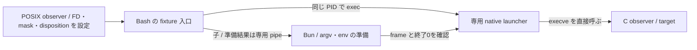

# process 置換と lock の寿命の実証

## 判定

[#33](https://github.com/treflebonbon/skills/issues/33) の実証用 fixture と比較記録。基準 source は `236b0f61d194c277f0bb4c79561939113ee6ea24`、Bun は1.4.4。Linux / WSL2 x86_64 で確認した。

**process 置換の旧契約を満たす方式は未確定であり、#33 は完了扱いにしない。** Bun を経由する `process.execve` の経路は PID・TTY・終了状態を維持するが、継承可能な FD と signal mask に旧 Python と異なる挙動がある。`spawn` は PID と親子関係が変わる。fixture が成功しても、この不適合を解消した証拠にはならない。

追加候補として、Bun を準備用の子 process に限定し、同じ PID の専用 native launcher が `execve(2)` を直接呼ぶ fixture を加えた。Linux / WSL2 のローカルでは FD・mask・Python の signal disposition・TTY と拒否条件を比較した。新しい source の3環境 CI は下記の追加実証欄で区別する。製品の native helper、配布方式、公開入口は未採用のまま。

lock は既存の `peer-request.sh` と同じ Perl の `flock(2)` を、Bun が開いた FD の open file description に適用する方式を検査した。3環境の合成入力で保持・競合・解放を確認したが、process 置換と対応 OS 全体の採用を決めたものではない。追加実証では、旧 Python の append/write-only・作成 mode と既存の書込み専用 file も検査する。

## 比較対象と観測方法

[Bun の実証用入口](../tests/fixtures/bun-process-lock.ts)を、[POSIX の観測用 C fixture](../tests/fixtures/bun-process-observer.c)から起動する。観測側が FD 9・`FD_CLOEXEC`・`SIGUSR1` の mask を設定し、置換前後の PID / PPID / PGID / SID、controlling TTY、foreground group、FD の device / inode、signal mask、argv を出力する。同じ C source から Node-API 6 の観測用 addon も build し、Bun 内で `process.execve` を呼ぶ直前の状態を読む。観測用 addon は状態を読み出すだけで、製品の execve / flock helper を提供・採用するものではない。

既存の `bin/codex-reviewer` に、本物の Codex の代わりに同じ C observer を渡して[旧版の corpus](../tests/fixtures/bun-process-lock-python.json)を採取した。既存の Python 関数、Git metadata の検出、argv・環境の組立てと `os.execvpe` を実際に通している。source SHA・各関連ファイルの SHA-256・Python 版・OS / kernel・コマンドを保存した。通常の Bun suite から Python を起動しない。raw namespace、Nix、実モデルの起動はこの比較に含まない。

FD は「番号が開いている」だけでなく、置換前後の device / inode を照合する。Bun の内部 FD に同じ番号が再利用された場合を、継承の成功に数えない。PID の比較には、target を直接 exec する POSIX 対照と、子を spawn する対照を置く。

## process の結果

| 境界                            | ローカルでの実測                                                                                                  | 判定                           |
| ------------------------------- | ----------------------------------------------------------------------------------------------------------------- | ------------------------------ |
| PID・親・process group・session | `process.execve` は置換前と一致し、`spawn` は別 PID / 親子関係になる                                              | 置換と spawn を区別できる      |
| argv・環境・終了                | 空引数、Unicode、shell 記号を literal に渡し、target の終了37を観測                                               | 確認済み                       |
| 継承可能 FD                     | 旧 reviewer と POSIX 対照は同じ FD 9 を維持。Bun 内の呼出し直前にも同じ FD はあるが、既に CLOEXEC。置換後にはない | Bun を含む経路が旧契約に不適合 |
| `FD_CLOEXEC`                    | CLOEXEC の FD は target に渡らない                                                                                | 確認済み                       |
| signal mask                     | 旧 reviewer / POSIX 対照と Bun 内の呼出し直前は block 済み `SIGUSR1` を維持。`process.execve` 後は解除            | 旧契約に不適合                 |
| 起動失敗                        | `ENOENT`・`EACCES`・`ENOEXEC` を捕捉して終了1。signal による異常終了ではない                                      | Bun 1.4.4 / この環境で確認済み |
| 対話 TTY                        | 実 PTY で stdin / stdout / stderr、controlling TTY と foreground group、Unicode 入力を観測                        | 確認済み                       |
| 中断・終了・timeout             | POSIX 対照と Bun の両方で、PTY の Ctrl-C は SIGINT / 130、SIGTERM と timeout は SIGTERM / 143                     | 確認済み                       |

[Bun の導入時の説明](https://bun.com/blog/release-notes/bun-v1.3.14)には stdio 以外の FD の close-on-exec と signal mask のリセットが記載されている。一方、同資料の失敗時 abort という説明は今回の1.4.4の実測とは一致しない。版をまたいで転用せず、例外の捕捉を fixture で検査する。

呼出し直前に FD 9 は元と同じ device / inode で開いているが、既に CLOEXEC だった。この実測だけで flag の変更を `process.execve` 呼出し自体に帰属させない。Bun の初期化と観測用 addon の load を含む経路を通った後の状態であり、将来の native 方式の判断にもこの区別を引き継ぐ。PTY の結果は process の終了に加えて terminal の出力終端を待って読む。

POSIX `execve` が mask と非 CLOEXEC の FD を保持する境界は、[Linux の execve(2)](https://man7.org/linux/man-pages/man2/execve.2.html)も参照。API が存在することや終了コードだけの一致を、旧契約との互換性の根拠にしない。`spawn` による signal 転送の代替実装は今回採用していない。

## lock の結果

親の Bun が lock file を開き、既存の Perl にその FD を明示的に渡す。Perl はその open file description に `LOCK_EX | LOCK_NB` を取得し、終了する。子が終了しても親の FD が保持を継続する。Linux の `flock` command や Python には依存しない。

- lock がないと別 process の取得は成功し、保持中は `busy` として拒否される。競合する holder の起動も拒否され、元の holder の保持は続く。
- 親の FD を close すると解放する。通常終了、SIGTERM、SIGKILL による終了でも解放する。
- lock FD を渡さない子は、生存中でも親の close 後に lock を延長しない。明示的に FD を継承させた対照だけは、親の close 後も保持する。対照は子の生存を検査し、子の終了後には再取得できることを確認する。
- lock FD を持つ親を `process.execve` で置換すると、target が生存中でも lock は解放される。host の admission lock を保持する process を置換せず、子の完了と結果返却まで親が保持する境界を維持する必要がある。

[flock(2)](https://man7.org/linux/man-pages/man2/flock.2.html)の open file description の寿命を使う方式であり、PID file や lock directory による stale 判定には置き換えない。advisory lock のため、非協調 writer に対する排他とは呼ばない。Perl の取得 process が終了したことと、lock が解放されたことも区別する。

## 準備・対応環境・再実行

既存の Bun 1.4.4、Node.js、開発依存に加え、観測用 C fixture のため `cc`・POSIX header・導入済み Node.js の Node-API header、lock の実証に Perl / `Fcntl` を必要とする。追加の npm package、FFI、通常利用時の自動 install / build は導入しない。C observer と観測用 addon は一時 directory に build し、終了時に削除する。payload に生成物を置かない。source / binary の hash と compiler / Node.js の版・header path・準備時間はテスト末尾の JSON に記録する。

追加候補を含む setup hook は105秒を上限とする。3回の compiler 各30秒と2回の版検出各5秒の合計100秒を外側でも確保するためで、各 subprocess の期限と通常テストの期限は維持する。以下の過去の CI 記録は、launcher 追加前の source に対するもの。

| 環境                                                                     | 状態                                     |
| ------------------------------------------------------------------------ | ---------------------------------------- |
| Linux / WSL2 x86_64、kernel 6.18.58.1-microsoft-standard-WSL2、Bun 1.4.4 | ローカルで確認済み                       |
| Linux x86_64 (`ubuntu-latest`)                                           | 修正後 CI で93 pass / 0 fail / skip なし |
| Linux aarch64                                                            | 修正後 CI で93 pass / 0 fail / skip なし |
| macOS aarch64                                                            | 修正後 CI で93 pass / 0 fail / skip なし |
| raw namespace / Nix closure                                              | 未実証。後続の隔離実証と区別する         |

```sh
npm ci --prefix development
npm run typecheck
lib/bun/run test tests/bun/process-lock.test.ts
npm test
```

ローカル検証は `~/runtime/skill-harness.md` の保護された実行境界から開始する。CI は既存の3環境の `npm run test:bun` に自動で含まれる。共通 task runner・tsconfig・workflow は変更しない。末尾の `boundary: "process-lock"` の JSON は実測値と採用未決を記録し、成功・失敗・skip はテスト結果で判断する。

## CI の実測履歴

初回の [run 43260194670](https://github.com/treflebonbon/skills/actions/runs/43260194670) は head `b3c7975015410f99a4f8741a8c3e53587bf3ae44` / checkout `78d57762308955397d5655d3b788a4ca88c15123` を検査した。Linux x86_64 と macOS aarch64 は各93 pass / 0 fail / skip なしだった。Node.js は順に24.22.2 / 22.23.4、compiler は Ubuntu GCC15.2.0 / Apple clang17.0.0。C source の SHA-256 は両方 `999b6c812cb784ac7a3db170cecc512b6935889454377ae86c233e55b98f5281`。

Linux の呼出し直前の FD 9 は CLOEXEC あり、macOS ではなしだった。両方で同じ FD の identity と block 済み SIGUSR1 を呼出し直前に観測し、置換後の FD 消失と mask の解除を確認した。local Linux の flag の変化を macOS へ転用しない。

Linux aarch64 は最初のコンパイル中、setup hook の既定5秒で子 process が停止した。75 pass / 1 fail で、今回の18件は未実行だった。初回の ARM の JSON に build / processExecve がないことも成功として扱わない。

コンパイルを6秒遅らせるローカル対照でも約5秒で同じ hook timeout を再現し、hook の上限を75秒にすると18 pass / 0 fail になった。各 child の期限は変更せず、全テストの期限を一括で緩めない。準備時間・終了 status / signal の記録も追加した。修正後の3環境の結果は、該当 head の job log と [PR #59](https://github.com/treflebonbon/skills/pull/59) で確認する。

修正後の [run 43263328778](https://github.com/treflebonbon/skills/actions/runs/43263328778) は head `1034c003eb1ebc42c1aeb1492fd6a33a9a49a8b3` / checkout `e51bc4301b83d4f388f278aacc34abc9c21927ca` を検査し、コード CI の5 job と3環境の全93件が成功した。各環境で今回の process / lock 18件も全件実行し、skip はない。Bun は3環境とも1.4.4。

| runner             | OS / kernel / host architecture  | Node.js  | compiler                                       | 準備 ms | Bun suite                 |
| ------------------ | -------------------------------- | -------- | ---------------------------------------------- | ------- | ------------------------- |
| `ubuntu-latest`    | linux 7.0.0-1019-azure / x86_64  | v24.22.2 | cc (Ubuntu 15.2.0-16ubuntu1) 15.2.0            | 438     | 93 pass / 0 fail / 0 skip |
| `ubuntu-24.04-arm` | linux 7.0.0-1017-azure / aarch64 | v22.23.4 | cc (Ubuntu 13.3.0-6ubuntu2~24.04.1) 13.3.0     | 350     | 93 pass / 0 fail / 0 skip |
| `macos-15`         | darwin 24.6.0 / arm64            | v22.23.4 | Apple clang version 17.0.0 (clang-1700.0.13.5) | 436     | 93 pass / 0 fail / 0 skip |

呼出し直前の FD 9 は Linux の両環境で CLOEXEC あり、macOS ではなしだった。3環境で同じ元の FD の identity と block 済み SIGUSR1 を観測し、置換後には FD 消失・mask 解除となった。C source の SHA-256 は3環境共通で `999b6c812cb784ac7a3db170cecc512b6935889454377ae86c233e55b98f5281`。準備時間はこの run の実測であり、compiler が常に同じ時間で終わるという保証ではない。

## 残る判断と後続への条件

#33 は open のまま `ready-for-human` とし、後続の blocking links を維持する。採用可能な方式が必要範囲で1つも確定していないため、3環境の suite の成功だけで依存を解除しない。

現在の追加実証は、Bun の外に元の FD・mask を残す専用 launcher 方式を対象とする。Bun 内で単に `execve(2)` を呼ぶことだけで解消すると仮定しない。製品の helper を加える場合は、ビルド・配布・runtime の準備、内部 FD の漏洩防止、失敗時の状態、3環境での実証を含めて判断し、成功前には採用しない。

lock の Perl 方式を後続で選ぶ場合も、隔離用 Nix closure の明示的な tool 選択と、親の保持範囲を同じ ticket で扱う。現在は実証 fixture と記録だけであり、公開入口を変更していない。repo 外の呼び出し元の更新はない。入口を切り替える ticket が、その時点の外部の対象と更新手順を報告する。

## 専用 native launcher の追加実証

[Bash の fixture 入口](../tests/fixtures/bun-exec-entry.sh)が、既存の `lib/bun/run` を使って [Bun の準備処理](../tests/fixtures/bun-exec-prepare.ts)を子として起動する。親は同じ PID の[専用 launcher](../tests/fixtures/bun-exec-launcher.c)に置換され、準備結果を pipe から読み、子の終了0を確認した後だけ target を `execve(2)` する。Bun は親の FD・mask に触れない。環境変数の値を launcher の argv に載せず、追加の pipe FD は target の起動前に閉じる。



### 比較元と拒否条件

[追加の Python corpus](../tests/fixtures/bun-exec-python.json)は head `f8598e7` の実 `bin/codex-reviewer` から採取した。入力は通常・block 済み SIGUSR1 と ignore 済み SIGINT・CLOEXEC・FD 3/9/63 の継承。基準 Python の3ファイルと観測 C の source hash、Python / OS の版を保存する。拒否 case は `with-env` と同じ `os.execvpe` primitive を Python stdlib から直接実行したものであり、`with-env` の Git / dotenv の準備全体を実行した証拠ではない。通常の Bun suite は保存済み JSON を読み、Python を起動しない。

Bash 単独の `exec` は、`execfail` があっても shebang のない実行可能テキストを shell として実行する対照を置いた。専用 launcher は text・空 file・不正 binary を `ENOEXEC` として拒否し、ENOENT・EACCES・directory の拒否も Python corpus と比較する。PATH 探索は新しい env の PATH・空要素・未指定時の `/bin:/usr/bin`・slash の有無・最初の非 ENOENT/ENOTDIR エラーの保持を検査し、`execvp` の shell fallback を使わない。shebang のある script の判定は kernel に委ねる。

Python は起動時に SIGPIPE / SIGXFSZ（定義される環境では SIGXFZ も）を ignore にする。観測側は SIGPIPE / SIGXFSZ を default に戻して seed し、launcher は旧 Python と同じ ignore 状態を設定する。親からの signal mask と SIGINT の ignore は維持する。単に「signal を変更しない」だけでは旧 Python と一致するという仮定を置かない。

### 検査する境界

- PID / PPID / PGID / SID、FD の identity と CLOEXEC、3/9/63 の継承と範囲3〜127の余分な FD、blocked mask、3種の signal disposition、空引数・Unicode・literal shell 記号、GIT_* 除去と marker を確認する。
- 既存の PTY 対照に launcher を加え、TTY / foreground、入力、Ctrl-C・SIGTERM・timeout の終了を比較する。
- 部分 frame・余分な field・準備の非0終了は、完全な frame が出力済みでも target を起動しない。pipe buffer より大きい準備結果も比較する。準備中の親の SIGTERM では子を終了させ、回収してから同じ signal で終了する。
- `lib/bun/` と `tests/fixtures/` の bytes・mode・file inventory を実行前後で比較する。生成 binary はテストの一時領域だけに build する。これは今回の fixture の不変性検査であり、製品配布物の導入・受入の証拠ではない。
- lock の追加 case は旧 Python と同じ O_WRONLY / O_APPEND / O_CREAT、0666 & ~umask を使う。Perl は書込み専用 FD を受け取り、競合・close 後の再取得を検査する。

### 実証と採用を区別する条件

追加候補のローカル実測は Linux / WSL2 x86_64・Bun 1.4.4。3環境の CI は、この変更を含む head の各 job log と JSON の `nativeLauncher` を確認する。過去の93件成功を追加候補の成功へ転用しない。

この fixture は argv / env の transport と exec 境界を比較する。reviewer の Git context / policy、`with-env` の準備全体、`codex-inner` の chdir と開始記録、namespace 設定を移植・受入したものではない。caller ごとの追加段階の環境・signal への影響、通常利用時の native binary の事前ビルド・配布・hash 固定、Nix closure は未確定。namespace の範囲と #33 の AC も変更しない。

エラー出力は実証用の prefix・errno 名/番号と終了1を比較する。Python の例外の repr・path・stderr の bytes 全体は再現していないため、公開 CLI の互換完了とはしない。prepare frame は16 MiBを上限とし、製品の ARG_MAX・準備中の SIGKILL 後の子 process の寿命・macOS の環境変数制約も、この実証だけで成立したと扱わない。追加 native helper と固定 pipe の方式は候補であり、製品への採用判断は別に残す。
