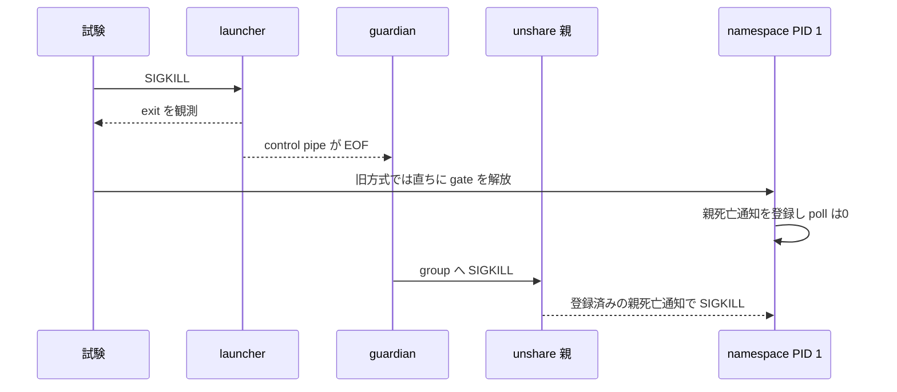

# 親死亡 pidfd 対照の gate 解放 race

2026-11-16 に、#33 の「親死亡の pidfd 検査を無効にした対照」が初回失敗・再確認成功になった原因を調査した。対象は `d0c66d6` の実証 harness。WSL2 の保護 wrapper 内での診断であり、通常 Linux x64／arm64 の正式実証には数えない。

## 原因

対照は namespace の PID 1 を `fork-child` で停止し、launcher を SIGKILL で終了させてから gate を解放していた。しかし launcher の `exit` は、guardian と `unshare` 親の終了まで保証しない。

`unshare` 親がまだ生きている間に gate を解放すると、PID 1 は `PR_SET_PDEATHSIG` を設定し、親の pidfd を検査する。このとき親は生存中なので `poll` は0を返す。検査を隠す fixture は正の戻り値だけを0へ変更するため、この経路には介入しない。その後 guardian が `unshare` 親を終了させると、登録済みの親死亡通知により PID 1 も終了する。対照が要求する準備開始・検査を隠した marker が揃わず、3秒で timeout していた。

同版の [util-linux 2.39.3 上流 source](https://www.kernel.org/pub/linux/utils/util-linux/v2.39/util-linux-2.39.3.tar.xz) の `sys-utils/unshare.c` は、子側で `prctl(PR_SET_PDEATHSIG, ...)` の後に親 pidfd を `poll(..., 0)` で検査する。実物の実行体に対する観測とこの順序を照合した。

これは検査を隠す対照の実行順序による誤失敗であり、通常の候補で子孫が残存した観測ではない。

## 再現と切分け

環境は kernel `6.18.58.1-microsoft-standard-WSL2`、x64、Bun 1.4.4、`unshare` util-linux 2.39.3、GCC 15.3.0。全コマンドを所定の `verification_env.py` 内で実行し、kernel／sysctl／LSM の設定は変更していない。

| 条件                                             | 観測                                                                           |
| ------------------------------------------------ | ------------------------------------------------------------------------------ |
| 元の対象1件を別 process で反復                   | 20回すべて成功                                                                 |
| 先行試験を含む元の順序                           | 1回目成功、2回目に同じ timeout                                                 |
| 準備開始を待つ部分だけを速く反復する一時 harness | 19回目に同じ timeout                                                           |
| 無関係な `sleep` を除去                          | 28回目に再現                                                                   |
| 追加の資格情報読取り、未使用 build も除去        | 33回目に再現                                                                   |
| gate 解放前後を pidfd で観測                     | 失敗時は解放前に所有子孫が全員生存し、timeout 後には全員終了                   |
| gate の read と `poll` を一時記録                | read は1 byte成功、`poll` は0、`revents` は0。I/O 失敗・起動の遅延と区別できた |
| 中間の親の終了を待つ変更だけを適用               | 速い反復で200回すべて成功                                                      |

速い反復では、失敗箇所より後にある5.1秒の残存待ちだけを省いた。これは観測待ちの再現用であり、全子孫5秒保証や対照の残存を証明する結果には使わない。後始末には元と同じ所有子孫の pidfd を使った。launcher を省いて `unshare` を直接起動する変更では stderr の経路が変わったため、同じ失敗の最小再現として採用していない。

## 修正と検証境界

恒久修正後、元の helper から5.1秒待ちだけを省いた反復は200回すべて成功した。5.1秒待ちを含む元の対象1件も成功し、実 Nix caller を含む全44件は3回とも42成功・補助 group の2件 skip・失敗0だった。CI 専用 group fixture がないローカル結果であり、正式実証の成功には数えない。型検査と関連する証跡判定16件も成功した。

元の対照を回帰検査として使い、`hiddenParentDeath` の場合だけ gate 解放前の同期を追加した。`NSpid` の末尾が1である所有 process を一意に特定し、それ以外の所有 process の終了を pidfd で待つ。PID 1 がまだ生存していることも同じ handle で確認する。解放前に終了を観測した PID 一覧を `controlParentsTerminatedBeforeRelease` として trial の JSON に保存する。

検査を隠した marker、準備開始、launcher 終了後5.1秒を超える残存、target 未起動、無関係な process の生存という元の比較条件は維持する。通常の SIGTERM／SIGKILL 試験の開始時点、gate 解放順序、全所有子孫5秒以内という上限は変更しない。`prctl`、実物の `unshare`、製品の launcher に変更は加えない。

診断用の一時 harness と trace は共有 scratch に隔離し、正式実証・製品の入力には追加しない。#33 は OPEN、#82 は #33 待ち、macOS 移行保留を維持する。
