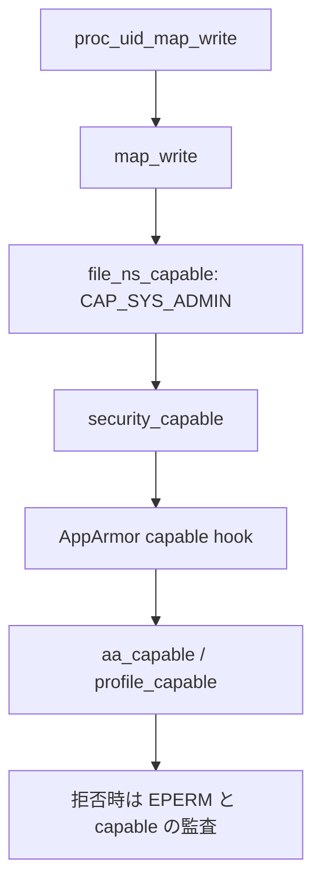

# UID mappingとAppArmor能力拒否の対応

2026-11-19時点のPhase 2補足。承認済み [run 44438396275 / attempt 1](evidence/linux-namespace-bash-audit/44438396275-1/README.md) の実測と、版を固定した公開sourceを照合した。実測したEPERMの再現条件を分解するための調査であり、修正・原因確定・正式実証の成功ではない。

## 実測と公開sourceの境界

| 対象             | 確認したこと                                                                                                                           | 未確認の範囲                                                                                 |
| ---------------- | -------------------------------------------------------------------------------------------------------------------------------------- | -------------------------------------------------------------------------------------------- |
| 実VM             | 両構成のkernel `7.0.0-1017-azure`、util-linux `2.39.3`、同じUID-map EPERM。各構成2 PIDでAppArmorのprofile遷移と `sys_admin` 拒否       | kernel / util-linux / AppArmorの完全なDebian package版、loaded policyのbytesとlocal override |
| util-linux       | 公式 `v2.39.3` tagのcommit `2da5c904e18fdcffd2b252d641e6f76374c7b406`                                                                  | Ubuntuの修正を含む実VMの実行体と、このupstream source全体の同一性                            |
| Ubuntu kernel    | 公開source版 `7.0.0-1017.17~24.04.1`、tag `Ubuntu-azure-7.0-7.0.0-1017.17_24.04.1` のcommit `90f5e10e3a3dc1273846689f4cee162f97b4b3df` | unameのABIが対応しても、実VMの完全なpackage revisionやbuildを証明しない                      |
| AppArmor profile | 公式 `v4.0.1` tagのcommit `b0eb95457bc2de401920308869d016e696c73664` にある既定profile                                                 | 実VMに同じ内容がloadされているとは認定しない                                                 |

Ubuntuの公開source版は [package情報](https://packages.ubuntu.com/source/noble-updates/linux-azure-7.0) と [DSC](https://archive.ubuntu.com/ubuntu/pool/main/l/linux-azure-7.0/linux-azure-7.0_7.0.0-1017.17~24.04.1.dsc) を参照し、公式Git tagをcommitへ解決した。DSCが示す差分archiveのサイズ・SHA-256も照合した。公開sourceの読取だけを行い、VMへのinstall・build・設定変更・追加journal検索は行っていない。

## argvが含む操作

util-linuxの [`case 'c'`](https://github.com/util-linux/util-linux/blob/2da5c904e18fdcffd2b252d641e6f76374c7b406/sys-utils/unshare.c#L839) は、`--map-current-user` で `CLONE_NEWUSER` と現在の実効UID/GIDへのmappingをまとめて指定する。`unshare()` の後、[`map_id` を呼び](https://github.com/util-linux/util-linux/blob/2da5c904e18fdcffd2b252d641e6f76374c7b406/sys-utils/unshare.c#L1037)、UID mapping、その後のsetgroups/GID mappingを処理する。`map_id` は対象を開いて書き込み、書込み失敗時に今回の形式のエラーを返す。`_PATH_PROC_UIDMAP` は [`/proc/self/uid_map`](https://github.com/util-linux/util-linux/blob/2da5c904e18fdcffd2b252d641e6f76374c7b406/include/pathnames.h#L106)。

従来の対照 `-- /usr/bin/true` はnamespace作成もmappingも省く。その対照の成功だけでは、namespace作成とmapping関連操作のどちらが再現に必要か分離できない。`--user -- /usr/bin/true` はnamespace作成を保ち、UID/GID mappingとsetgroupsの指定を外す比較になる。UID書込みだけを単独で省く比較ではない。

## 公開kernel sourceの能力検査経路

版を固定したUbuntu kernelでは、次の経路を確認した。

- [`kernel/user_namespace.c`](https://git.launchpad.net/~canonical-kernel/ubuntu/+source/linux-azure/+git/noble/tree/kernel/user_namespace.c?id=90f5e10e3a3dc1273846689f4cee162f97b4b3df#n992): `map_write` は戻り値を `-EPERM` にし、mapping内容の解析より前に `file_ns_capable(file, map_ns, CAP_SYS_ADMIN)` を検査する。`proc_uid_map_write` の `CAP_SETUID` 引数と、この先行する `CAP_SYS_ADMIN` 検査は別である。
- [`kernel/capability.c`](https://git.launchpad.net/~canonical-kernel/ubuntu/+source/linux-azure/+git/noble/tree/kernel/capability.c?id=90f5e10e3a3dc1273846689f4cee162f97b4b3df#n433): `file_ns_capable` はファイルを開いた資格情報 `file->f_cred` で `security_capable` を呼ぶ。
- [`security/security.c`](https://git.launchpad.net/~canonical-kernel/ubuntu/+source/linux-azure/+git/noble/tree/security/security.c?id=90f5e10e3a3dc1273846689f4cee162f97b4b3df#n659) と [`security/apparmor/lsm.c`](https://git.launchpad.net/~canonical-kernel/ubuntu/+source/linux-azure/+git/noble/tree/security/apparmor/lsm.c?id=90f5e10e3a3dc1273846689f4cee162f97b4b3df#n208): capable hookからAppArmorのlabelとprofileの能力検査へ進む。
- [`security/apparmor/capability.c`](https://git.launchpad.net/~canonical-kernel/ubuntu/+source/linux-azure/+git/noble/tree/security/apparmor/capability.c?id=90f5e10e3a3dc1273846689f4cee162f97b4b3df#n121): profileの能力許可を調べ、拒否時の `-EPERM` と `OP_CAPABLE` 監査を構成する。

また、[`security/apparmor/task.c`](https://git.launchpad.net/~canonical-kernel/ubuntu/+source/linux-azure/+git/noble/tree/security/apparmor/task.c?id=90f5e10e3a3dc1273846689f4cee162f97b4b3df#n427) のnamespace権限検査は、制限対象のunconfined processを `unprivileged_userns` profileへ移す要求を作り、実測と同じ遷移メッセージを監査へ渡す。[`apparmor_userns_create`](https://git.launchpad.net/~canonical-kernel/ubuntu/+source/linux-azure/+git/noble/tree/security/apparmor/lsm.c?id=90f5e10e3a3dc1273846689f4cee162f97b4b3df#n1245) は新しい資格情報のlabelへ反映する。

公開されている [AppArmor既定profile](https://gitlab.com/apparmor/apparmor/-/blob/b0eb95457bc2de401920308869d016e696c73664/profiles/apparmor.d/unprivileged_userns) はuser namespace作成を許し、capabilityをaudit付きでdenyする。任意のlocal overrideのincludeもある。[Ubuntu 24.04の公式説明](https://documentation.ubuntu.com/release-notes/24.04/#unprivileged-user-namespace-restrictions) とも整合する。ただし実VMのloaded policy全内容は取得していない。

**推論**: このsource経路は、実測したUID-map書込みのEPERMと `capability=21 capname="sys_admin"` の拒否を結ぶ具体的な説明になる。実VM上の当該write syscallと能力検査の直接traceはなく、原因確定や全PIDでの同じ経路の証明にはしない。

## 監査が一致しないPID

実測のBash最小argv6 PID中、4 PIDは遷移と拒否を取得し、2 PIDは `no-matching-events` だった。公開sourceには、[`audit_caps` の同じ資格情報・能力に対するper-CPUの重複監査抑制](https://git.launchpad.net/~canonical-kernel/ubuntu/+source/linux-azure/+git/noble/tree/security/apparmor/capability.c?id=90f5e10e3a3dc1273846689f4cee162f97b4b3df#n67) と、[`kauditd_printk_skb` の `printk_ratelimit()` によるring buffer出力制限](https://git.launchpad.net/~canonical-kernel/ubuntu/+source/linux-azure/+git/noble/tree/kernel/audit.c?id=90f5e10e3a3dc1273846689f4cee162f97b4b3df#n582) がある。これらはログが常に一対一で残ると仮定できない根拠になる。

実VMのaudit経路、rate limit、backlog、遅延は未取得で、どちらが未一致2 PIDの理由かは未確認。重複cacheは資格情報の参照を保持するので、異なるPIDの単純なポインタ再利用を理由にしない。検索の再実行や時間窓拡大も行っていない。

## 比較結果と残る制約

既存の共通Bash比較を使う `mode=probe-userns` を承認後に1回実行した。Perl基準測定の最小argv・普通の対照を各3回実行し、正確なEPERMと対照成功を確認した場合だけ、Bash直接側で `--map-current-user -- /usr/bin/true` と `--user -- /usr/bin/true` を各3回比較する。最大12 namespace probe/architecture、計24回と、別に版確認各1回。新しいjournal検索はしない。詳細は [比較の契約](bun-process-linux-feedback-loop.md#mapping関連操作の最小化-namespace作成だけを残す) に記す。

確認済み（confirmed）: [run 44458506354 / attempt 1](evidence/linux-namespace-userns/44458506354-1/README.md) はsource / workflow `e25a535074c26f2520d1e09b4f9ac6cf26ff354c` に固定し、両構成とも `id-mapping-required` だった。Perl基準測定を含め計24回を測り、Bashのmapping関連操作付きは各3回同じEPERM、namespace作成だけの対照は各3回成功した。今回の条件ではmapping関連操作が再現に必要だった。UID書込みだけの分離や、前回runの監査と今回のPIDの直接対応ではない。新しいjournal検索・設定変更・artifact取得/読取は行っていない。実VMのloaded policyと当該syscallの直接因果は引き続き未確認である。Phase 2全体・#33は未完了、#82は#33待ち、macOS 15と全子孫5秒保証の未解決を維持する。

確認済み（confirmed）: [run 44486490046 / attempt 1](evidence/linux-namespace-uid/44486490046-1/README.md) をsource / workflow `f2d0e838ffc05f2009b4dc22580c45057c13ce93`、mode `probe-uid` で承認どおり1回実行し、両構成とも `uid-mapping-reproduced` だった。同じBashの現行argvと `--map-user=1001 -- /usr/bin/true` は各3回同じUID-map EPERM、namespace-only対照は各3回成功した。GID mappingとsetgroupsの指定を省いたargvでも今回の症状は再現した。ただし、VM上の数値表記のユーザー名 `1001` の解決先は記録しておらず、「同じUIDを指定した比較」という前提は未確認である。後から追加した検索検査の実測は、[後続run 44542479679](evidence/linux-namespace-uid/44542479679-1/README.md) に分けて記録した。 [UID単独比較の契約](bun-process-linux-feedback-loop.md#uid-mapping単独の最小化) に条件を記す。UID-onlyのargvでも再現したが、当該syscallとAppArmor拒否の直接因果やloaded policyは引き続き未確認である。

確認済み（confirmed）: [run 44542479679 / attempt 1](evidence/linux-namespace-uid/44542479679-1/README.md) はsource / workflow `915de5f50fa2ff3154b1cb0dd71cdbc596ff87ad` に固定した承認済み1runで、両構成とも数値名検査が `ready / numeric-fallback` となった。検索時点で数値表記と同名の別アカウントへ解決される条件を除外した後も、同じBashの現行argvとUID-onlyは各3回同じUID-map EPERM、namespace-only対照は各3回成功した。公開JSON44行・全30 probeと出所を照合した。

今回のx64は `7.0.0-1014-aws`、arm64は `7.0.0-1017-azure`。x64は旧runのimage・kernel・祖先などと異なるため、検索検査だけを変えたrun間差分実験とは扱わず、各VM内の比較として解釈する。本書で参照したAzure kernelの固定sourceを、新しいx64 kernelへ対応済みとは扱わない。名前検査後のNSS変化、実unshareの当該syscall、拒否時LSM、loaded policy全内容と直接因果は未観測である。新しいjournal検索・設定変更・artifact取得/読取・追加dispatchは行っていない。Phase 2全体・#33未完了、#82待ち、macOS 15と全子孫5秒保証の未解決を維持する。
