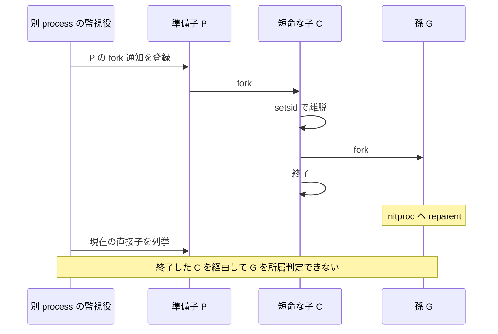

# macOS 15 の準備子孫終了方式の追調査

調査日: 2026-11-17。対象: [#33](https://github.com/treflebonbon/skills/issues/33)、親仕様 [#29](https://github.com/treflebonbon/skills/issues/29)。repo の比較元は `186eddf8eb8281867639a91053f7070c24da3386`。

## 結果と設計上の扱い

今回確認した一次資料では、macOS 15 を含む現行範囲で、承認済みの全準備子孫の5秒終了保証を満たす方式を確認できなかった。kqueue の追跡指定は対象版の実装で拒否され、coalition の管理には権限条件があり、coalition の terminate は process の一括 kill ではない。実証へ進める適合候補は未確定である。これは調査範囲の結果であり、macOS での実現不可能性の証明ではない。

[ADR 0002](adr/0002-native-exec-and-perl-flock.md) と [ADR 0003](adr/0003-os-specific-preparation-containment.md) の契約を維持する。#33 は未完了、#82 と後続は依存待ちとし、方式未成立の macOS を成功扱いする fallback は設けない。Linux の実証結果は [既存記録](bun-process-namespace-proof.md)を参照する。

## 維持する条件

- launcher が中断を受理した時点、または launcher だけに SIGKILL を送った時点から、準備所有の全子孫を5秒以内に終了させる。`setsid`／`setpgid`、fork、SIGTERM の block／ignore を含める。
- 準備中の target は起動せず、無関係な process と起動後の target は終了対象にしない。
- 成功時の元の PID／PPID／PGID／TTY／FD identity・CLOEXEC／signal mask・ignore／argv／env と、正常な5秒超の準備を維持する。既存の Nix／shellHook が作る有効な子孫を禁止して条件を満たしたことにしない。
- macOS 15 の対応範囲と明示的な `cc` 準備を維持する。特権 monitor の追加や、macOS 27 への下限引上げは採用範囲に含めない。

これは上記 ADR の再掲であり、新しい native helper の採用決定ではない。

## 対象版と根拠の強さ

Apple の [macOS 15.0 公開 manifest](https://github.com/apple-oss-distributions/distribution-macOS/blob/macos-150/release.json) が指定する `xnu-11215.1.10` を調べた。以下の XNU のリンクはその tag に固定し、可変な `main` の挙動を macOS 15 の根拠に使わない。macOS 15 の全更新版・arm64 実機の動作確認とは区別する。

Apple Developer Documentation は2026-11-17の参照内容であり、OS ごとの実測ではない。公開 launchd source `launchd-842.92.1` は旧版資料として扱い、macOS 15 の launchd 実装と同一とは扱わない。今回の実行 host は Linux x86_64 で、macOS の compile／実行はしていない。

## 候補の判定

| 候補                             | 資料で確認できた条件                                                                                                     | 現契約に対する判定                                                                                  |
| -------------------------------- | ------------------------------------------------------------------------------------------------------------------------ | --------------------------------------------------------------------------------------------------- |
| 専用 process group と guardian   | `setsid`／`setpgid` で別 group を作れる。                                                                                | 元 PGID の kill では離脱子孫を回収できない。既存方式の再利用だけでは不足。                          |
| kqueue `NOTE_TRACK`              | 対象 XNU の `filt_procattach` は `NOTE_TRACK`／`NOTE_TRACKERR`／`NOTE_CHILD` を含む登録に `ENOTSUP` を返す。             | FreeBSD の再帰追跡を Darwin に持ち込む方式は使えない。                                              |
| `NOTE_FORK` と `libproc` polling | fork の通知と現在の子一覧は、履歴を保持する再帰的な所有集合の取得ではない。                                              | 観測前の fork・親終了・reparent を取りこぼす経路を解消できない。                                    |
| process coalition                | create／terminate／reap は caller が privileged coalition に属するか検査する。terminate 後も既存 member は fork できる。 | 無権限の専用集合の作成・全 member の一括終了を提供する方式とは確認できない。                        |
| Audit session                    | 自 session の port 取得は無権限で可能。他 ASID の port 取得と auditon の A_GETPINFO_ADDR には権限検査がある。            | session の識別から、準備子孫全体の PID の列挙・終了へつなぐ無権限の方式は確認できない。             |
| `launchd` job／XPC               | 公開旧版の `AbandonProcessGroup` は job と同じ PGID の残存 process を扱う。                                              | この契約を根拠に、別 group／session を含む全子孫の終了を保証できない。macOS 15 の別機構は未確認。   |
| Foundation `Process.terminate()` | `SIGTERM` を送り、無視している process を終了できるとは限らない。                                                        | block／ignore の受入条件を満たす強制終了手段にはならない。                                          |
| App Sandbox                      | 公開資料は entitlement による資源アクセス制限を説明する。                                                                | 全子孫を保持・一括終了する契約は確認できない。fork や exec の禁止による互換性の縮小は採用しない。   |
| Endpoint Security                | 通常 client は entitlement・TCC と root の条件を持つ。descendant client は macOS 27.0 以降で entitlement を要する。      | 通常 client の特権 monitor は ADR 0003 で除外済み。descendant client は macOS 15 を対象にできない。 |

group 離脱の根拠は対象版の [`setsid_internal`／`setpgid`](https://github.com/apple-oss-distributions/xnu/blob/xnu-11215.1.10/bsd/kern/kern_prot.c)。kqueue は [header の非対応宣言](https://github.com/apple-oss-distributions/xnu/blob/xnu-11215.1.10/bsd/sys/event.h) と [`filt_procattach`／`filt_procevent`](https://github.com/apple-oss-distributions/xnu/blob/xnu-11215.1.10/bsd/kern/kern_event.c)を照合した。`NOTE_FORK` の通知を受け取れることを、子 PID を欠落なく再帰追跡できることに読み替えない。

coalition は [`coalition` の権限検査と terminate の仕様](https://github.com/apple-oss-distributions/xnu/blob/xnu-11215.1.10/bsd/kern/sys_coalition.c)を確認した。`COALITION_OP_TERMINATE` は新規 spawn を制限し、空になった際の通知を設定する操作で、既存 member の fork を止めない。`COALITION_OP_REAP` も空になった coalition の資源回収である。これらを Linux の `cgroup.kill` と同等とは扱わない。通常の caller が準備専用の privileged coalition を安全に用意できる根拠は得られていない。

Audit session は [session port の取得と join](https://github.com/apple-oss-distributions/xnu/blob/xnu-11215.1.10/bsd/security/audit/audit_session.c)、[auditon の権限分岐と A_GETPINFO_ADDR](https://github.com/apple-oss-distributions/xnu/blob/xnu-11215.1.10/bsd/security/audit/audit_syscalls.c)を照合した。自 session の port を無権限で得られることは、全 member の列挙・kill の保証ではない。ここで確認した取得・join の操作から、準備所有の全子孫を安全に終了する方式は導けない。

launchd は [固定した旧版 man source](https://github.com/apple-oss-distributions/launchd/blob/launchd-842.92.1/man/launchd.plist.5)を参照した。Foundation は [Apple の `terminate()`](<https://developer.apple.com/documentation/foundation/process/terminate().md>)、sandbox は [Apple App Sandbox](https://developer.apple.com/documentation/security/app-sandbox.md)を参照した。今回、未文書化の sandbox rule を製品の保証に組み込む提案はしていない。

ES の条件は [通常 client](<https://developer.apple.com/documentation/endpointsecurity/es_new_client(_:_:).md>)、[作成結果の root 条件](https://developer.apple.com/documentation/endpointsecurity/es_new_client_result_t.md)、[descendant client の availability と entitlement](<https://developer.apple.com/documentation/endpointsecurity/es_new_descendants_client(_:_:).md>)による。監視 scope の取得と、イベント欠落時を含む安全な一括終了も別の条件である。

## polling を高速化するだけでは解消しない点

以下は対象版の fork 通知、[proc_listchildpids の PPID による列挙](https://github.com/apple-oss-distributions/xnu/blob/xnu-11215.1.10/libsyscall/wrappers/libproc/libproc.c)、[親終了時の reparent 処理](https://github.com/apple-oss-distributions/xnu/blob/xnu-11215.1.10/bsd/kern/kern_exit.c)から考えられる実行順序であり、今回 macOS で実測したログではない。

この経路では、観測間隔を短くしても C が生存中に必ず列挙できるとは限らない。全 PID の snapshot も、過去の親子関係を復元する根拠にはならない。環境変数と command line は子孫が変更できる。同一 UID だけでは無関係な process と区別できない。未知の process を残すことと、所属を確定せず kill することの両方を拒否する必要がある。

## 次候補を実証へ進める条件

新しい候補は、まず以下を対象版の一次資料または小さい対照試験で示す必要がある。単に guardian を別 process に移したことや、通常の子孫を終了できたことだけでは不足する。

1. **所有集合の維持**: 準備実行前に管理を開始し、fork／exec／group・session 離脱／reparent を経ても全準備子孫の所属を失わない。対象外の process と区別できる。
2. **終了と本人確認**: launcher の単独 SIGKILL 後にも終了役が生存し、block／ignore と並行 fork を含めて5秒以内に停止できる。PID 再利用やイベント欠落が無関係 process の kill と未知子孫の残存につながらない。
3. **既存契約との両立**: macOS 15・通常の明示準備・既存の有効入力で成立し、target の元の identity と状態を維持する。追加の権限・署名・配布方式が必要なら実装前に判断事項として戻す。

資料上この3条件を満たす候補が見つかった段階で、既存の実証入口に最小の fixture を加える。初期化前／準備中／出力後の中断、離脱子孫、TERM block／ignore、無関係 process、正常な5秒超の準備と旧 corpus を対照する。観測前の harness cleanup や skip を採用成功の証拠にしない。

## 今回の完了範囲

macOS 15.0 に対応する公開 source と候補の不適合・不足条件を整理した。製品 code、accepted ADR、依存関係、CI、共有設定、署名・権限には変更を加えていない。実装を解禁できる方式の確定と macOS 実機での受入は未完了であり、#33・#82 を完了扱いにしない。
